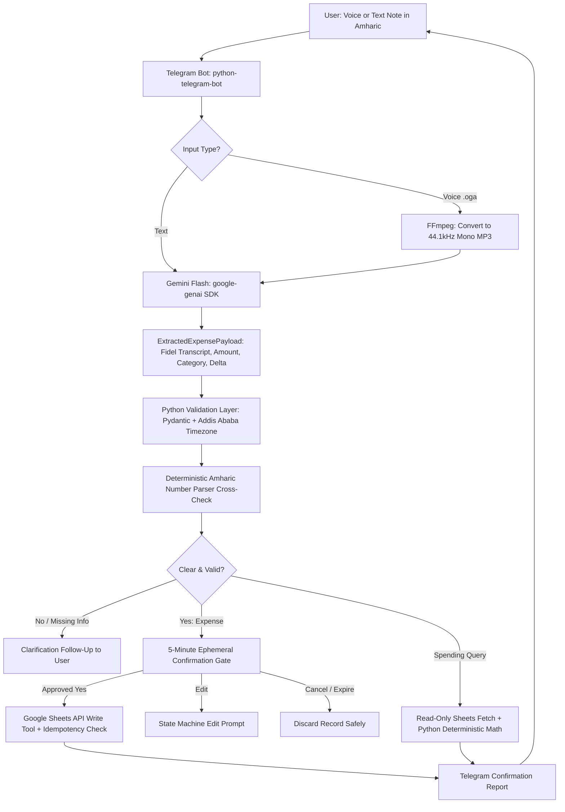

# Amharic Voice Expense Agent

**Status:** MVP Implemented & Empirical Benchmark Finished (170 automated unit tests passing)  
**Purpose:** Turn Amharic voice and text expense notes into validated, user-confirmed records in Google Sheets, and answer spending questions using deterministic calculations.  
**Tech Stack:** Python 3.10+ · Telegram Bot API (`python-telegram-bot`) · Google Gemini (`google-genai` SDK) · Google Sheets API (`gspread`) · FFmpeg · Pydantic v2  
**Timezone:** `Africa/Addis_Ababa` (UTC+3) · **Currency:** `ETB` (Ethiopian Birr)

---

## 1. Problem and Solution

Everyday personal expenses are easy to forget and tedious to type out into spreadsheets. This project provides a voice-first Telegram agent that allows users to speak naturally in Amharic, for example:

> **"ትናንት ለትራንስፖርት ሁለት መቶ ሃምሳ ብር ከፈልኩ።"**  
> *(Meaning: "I spent 250 birr on transport yesterday.")*

### What the System Does:
1. **Listens & Transcribes:** Downloads Telegram voice notes (`.oga`), converts them to MP3 via FFmpeg, and transcribes the speech verbatim into Amharic Fidel script using Google Gemini.
2. **Extracts & Understands:** Identifies the user's intent (`add_expense`, `spending_query`, or `clarification_needed`) and extracts structured fields (amount, category, relative date delta, description).
3. **Validates & Cross-Checks:** Enforces strict Pydantic schemas, resolves Gregorian dates in East Africa Time (`Africa/Addis_Ababa`), and cross-checks extracted amounts against a deterministic Amharic number parser.
4. **Human-in-the-Loop Confirmation Gate:** Displays an interactive proposal card with inline buttons (`[✅ አዎ / Yes]`, `[✏️ አርም / Edit]`, `[❌ ሰርዝ / Cancel]`) with an ephemeral 5-minute timeout. **No financial write ever occurs without explicit user approval.**
5. **Idempotent Storage:** Upon approval, appends the record to Google Sheets, using `source_message_id` deduplication to prevent double entries.
6. **Deterministic Spending Queries:** Answers queries such as *"ምን ያህል ወጪ አደረግኩ?"* (How much did I spend?) by querying Google Sheets and computing sums and category breakdowns in pure Python—never by hallucinating numbers or modifying records.

---

## 2. Why It Is "Agentic AI" (Architectural Principle)

An LLM alone is simply a next-token predictor. An **Agentic AI application** uses a foundation model within a governed loop that perceives environment state, interprets intent, formulates tool actions, observes tool feedback, and asks for clarification when information is missing.

```text
┌────────────────────────────────────────────────────────┐
│                   AGENTIC REASONING                    │
│  - Multimodal perception (Voice -> Amharic Fidel)       │
│  - Intent understanding (Expense vs Query vs Clarify)  │
│  - Entity extraction & relative time delta mapping     │
│  - Autonomous clarification generation on missing info │
└──────────────────────────┬─────────────────────────────┘
                           │ (Proposes Structured Action)
                           ▼
┌────────────────────────────────────────────────────────┐
│              DETERMINISTIC GUARDRAILS                  │
│  - Pydantic schema validation                          │
│  - Deterministic Amharic number parser cross-check     │
│  - Addis Ababa timezone enforcement                    │
│  - Idempotency & duplicate check                       │
│  - 5-minute ephemeral state timeout                    │
│  - Human-in-the-Loop confirmation gate                 │
└──────────────────────────┬─────────────────────────────┘
                           │ (Authorized Tool Call)
                           ▼
┌────────────────────────────────────────────────────────┐
│                  ENVIRONMENT TOOLS                     │
│  - Google Sheets API Append / Query                    │
│  - Telegram Bot API Notifications                      │
└────────────────────────────────────────────────────────┘
```

### The Core Principle:
> **Gemini proposes; Python validates and controls; tools perform actions; Google Sheets stores records; the user approves financial writes.**

### What Makes It Agentic:
- **Multimodal Environmental Perception:** Ingests raw spoken audio in an under-resourced language (Amharic) and derives structured intent.
- **Dynamic Branching & Tool Selection:** Classifies whether an input is a write mutation, a read query, or ambiguous text requiring follow-up.
- **Ambiguity Self-Assessment:** If critical information is missing (e.g., amount not mentioned), the agent recognizes the gap and autonomously generates a contextual Amharic clarification question (*"ስንት ብር እንደከፈሉ በግልጽ ይንገሩኝ?"*).
- **Tool Augmentation:** Executes real-world side effects against external APIs (Telegram, Google Sheets).

### What It Is NOT (Honest Boundary):
- It is **not** an unconstrained, open-ended autonomous agent (like AutoGPT) that can execute arbitrary code or wander into unintended actions.
- In financial software, **uncontrolled autonomy is a risk**. The agentic workflow is strictly guardrailed: the model proposes, deterministic logic inspects and bounds, and the human remains the final authority before financial data is written.

---

## 3. System Architecture



### Component Responsibilities

| Module | File | Responsibility |
|---|---|---|
| **Bot Entrypoint** | [`main.py`](file:///C:/Users/OMEGA/Documents/Amharic_voice_expense_agent/main.py) | Telegram handlers, async polling, authorization checks, confirmation callback dispatch, and edit state management. |
| **Agent Core** | [`agent.py`](file:///C:/Users/OMEGA/Documents/Amharic_voice_expense_agent/agent.py) | Interfaces with Google Gemini SDK (`google-genai`), enforces JSON schema extraction, handles model fallbacks, and validates extracted payloads. |
| **Amharic Numbers** | [`amharic_numbers.py`](file:///C:/Users/OMEGA/Documents/Amharic_voice_expense_agent/amharic_numbers.py) | Full deterministic parser for Amharic number words, teens, compound numbers, Arabic digits, scales (*መቶ*, *ሺህ*, *ሚሊዮን*), and fractions (*ተኩል*, *ሩብ*). |
| **Validation Layer** | [`validation.py`](file:///C:/Users/OMEGA/Documents/Amharic_voice_expense_agent/validation.py) | Pydantic `Expense` schema, Addis Ababa timezone conversion, and hybrid model-driven relative date resolution (`days_ago_delta`). |
| **Google Sheets** | [`sheets_service.py`](file:///C:/Users/OMEGA/Documents/Amharic_voice_expense_agent/sheets_service.py) | Service account authentication, header auto-initialization, duplicate message prevention, and read/write operations. |
| **Spending Service** | [`spending_service.py`](file:///C:/Users/OMEGA/Documents/Amharic_voice_expense_agent/spending_service.py) | Read-only analytics, category detection, and deterministic sums/breakdowns in pure Python. |
| **Audio Processing** | [`audio.py`](file:///C:/Users/OMEGA/Documents/Amharic_voice_expense_agent/audio.py) | Voice file download handling, binary FFmpeg resolution, and `.oga` to MP3 conversion. |
| **Error & Safety** | [`error_handler.py`](file:///C:/Users/OMEGA/Documents/Amharic_voice_expense_agent/error_handler.py) | Token masking filter (`SecretMaskingFilter`), exponential backoff retry decorator (`with_retry`), and 5-minute TTL pending confirmation store. |

---

## 4. Implemented Workflows

### 4.1 Record an Expense (Voice or Text)
1. **Receive:** Telegram delivers a voice note or text message.
2. **Audio Conversion:** If voice, `audio.py` converts the `.oga` file to a 44.1kHz mono MP3.
3. **Verbatim Transcription & Extraction:** Gemini extracts:
   ```json
   {
     "transcript": "ትናንት ለትራንስፖርት 250 ብር ከፈልኩ።",
     "amount": 250.0,
     "currency": "ETB",
     "category": "Transport",
     "date_expression": "ትናንት",
     "days_ago_delta": -1,
     "intent": "add_expense",
     "is_clear": true
   }
   ```
4. **Validation & Grounding:**
   - Python computes the exact Gregorian date (`YYYY-MM-DD`) using `days_ago_delta` in `Africa/Addis_Ababa` time. Future dates are rejected.
   - The deterministic Amharic number parser cross-checks the extracted amount against the verbatim transcript.
5. **Confirmation Gate:** An inline keyboard is presented to the user:
   ```text
   📝 የቀረበ የወጪ መረጃ (Expense Proposal)
   ━━━━━━━━━━━━━━━━━━━━
   💰 መጠን (Amount): 250.00 ETB
   🏷️ ምድብ (Category): Transport
   📅 ቀን (Date): 2026-10-22 (ትናንት)
   🗒️ ማስታወሻ (Description): Transport expense
   🎙️ የድምፅ ጽሑፍ (Transcript): ትናንት ለትራንስፖርት 250 ብር ከፈልኩ።
   ━━━━━━━━━━━━━━━━━━━━
   ይህ ወጪ ወደ Google Sheet ይመዝገብ? (Save this expense?)
   ⏱️ ማስታወሻ: ይህ ጥያቄ ከ5 ደቂቃ በኋላ ጊዜው ያልፋል።

   [✅ አዎ (አስቀምጥ) / Yes]  [✏️ አርም / Edit]
   [❌ ሰርዝ / Cancel]
   ```
6. **User Action:**
   - **Confirm:** Verified row is written to Google Sheets with idempotency check. Success is reported **only** after Google Sheets returns confirmation.
   - **Edit:** Bot prompts the user for corrected amount/details and updates the proposal without losing state.
   - **Cancel / Timeout:** Pending state is deleted; no row is written.

### 4.2 Answer a Spending Question (Read-Only)
- User asks: *"ጠቅላላ ወጪዬ ስንት ነው?"* or *"ለትራንስፖርት ምን ያህል አወጣሁ?"*
- `spending_service.is_spending_query()` routes the message to the read-only query pipeline.
- All records are fetched from Google Sheets; totals, transaction counts, and category breakdowns are calculated deterministically in Python.
- **Zero writes occur** during query operations.

---

## 5. Google Sheets Data Model

The application automatically initializes and maintains an 8-column schema:

| Column | Name | Description | Example |
|---|---|---|---|
| A | `transaction_id` | Unique UUID generated by the agent | `TX-9A4B8F12` |
| B | `created_at` | Record creation timestamp in Addis Ababa time | `2026-10-23T14:30:00+03:00` |
| C | `transaction_date` | Resolved Gregorian date (`YYYY-MM-DD`) | `2026-10-22` |
| D | `amount` | Numeric amount in Ethiopian Birr | `250.00` |
| E | `currency` | Currency code (strictly `ETB`) | `ETB` |
| F | `category` | Standardized category | `Transport` |
| G | `transcript` | Verbatim Fidel transcript of what was spoken | `ትናንት ለትራንስፖርት 250 ብር ከፈልኩ።` |
| H | `source_message_id` | Composite Telegram key (`chat_id:message_id`) for idempotency | `987654321:45` |

---

## 6. Build Milestones & Implementation Status

- [x] **Milestone 1 — Text Expense Pipeline**
  - Extract structured fields with Gemini JSON schema enforcement.
  - Validate output and resolve dates deterministically in `Africa/Addis_Ababa`.
  - Save records only after user confirmation.
  - Verify Google Sheets write responses.
- [x] **Milestone 2 — Telegram Interactive Bot**
  - Async bot architecture with `python-telegram-bot` v21+.
  - Inline confirmation, edit mode, cancellation, and 5-minute TTL expiration.
  - User authorization checking (`ALLOWED_USER_IDS`).
- [x] **Milestone 3 — Amharic Voice Ingestion**
  - Download voice notes and convert `.oga` to MP3 via FFmpeg.
  - Verbatim Fidel transcription using Gemini audio processing.
  - Deterministic Amharic number parsing (`amharic_numbers.py`) covering units, tens, compound teens, scales, and fractions.
  - Unclear audio and missing information clarification questions.
- [x] **Milestone 4 — Deterministic Spending Analytics**
  - Read-only routing for queries like *"ጠቅላላ ወጪዬ ስንት ነው?"*.
  - Strict separation of read tools from write tools.
  - Accurate summary calculation and category breakdown in Python.
- [x] **Milestone 5 — Reliability, Safety & Testing**
  - Idempotency checks (`source_message_id`) preventing duplicate writes.
  - Sensitive token masking in logs (`SecretMaskingFilter`).
  - Exponential backoff retry on Gemini API rate limits (`with_retry`).
  - Model fallback waterfall (`gemini-3.5-flash-lite` -> `gemini-3.5-flash` -> `gemini-3.8-flash`).
  - **170 automated unit tests passing across 9 test suites.**
- [x] **Milestone 6 — Empirical Benchmark Evaluation**
  - Full evaluation runner (`run_eval.py`) supporting `.aac`, `.amr`, `.m4a`, and `.oga` mobile voice notes.
  - Standardized 50-sample dataset (`Eval/dataset.csv`) across diverse speakers, noise levels, and financial intent groups.
  - Automated WER (strict & number-normalized), extraction accuracy, and tool selection metrics.
  - Complete mock safety ensuring zero writes to Google Sheets during evaluation.

### Future Work & Roadmap
- [ ] **Bill & Recurring Payment Reminders:** Background scheduler (e.g. APScheduler/Celery) to deliver proactive notifications for upcoming bills.
- [ ] **Ethiopian Calendar Support:** Convert and display dates using the Ge'ez calendar (*ዓመተ ምሕረት*).
- [ ] **Persistent State Store:** Migrate `PendingConfirmationManager` from in-memory dictionaries to Redis/SQLite so unconfirmed proposals survive bot restarts.

---

## 7. Setup & Installation Guide

### Prerequisites
- Python 3.10+
- FFmpeg installed and available on system `PATH` (or install `imageio-ffmpeg`)
- Telegram Bot Token (from [@BotFather](https://t.me/botfather))
- Gemini API Key (from [Google AI Studio](https://aistudio.google.com/))
- Google Cloud Service Account JSON key with Google Sheets API enabled

### 1. Clone & Set Up Virtual Environment
```bash
git clone https://github.com/muhe-byte/Amharic_voice_expense_agent.git
cd Amharic_voice_expense_agent

# Create virtual environment
python -m venv .venv

# Activate environment:
# Windows (PowerShell):
.venv\Scripts\Activate.ps1
# Linux / macOS:
source .venv/bin/activate
```

### 2. Install Dependencies
```bash
pip install -r requirements.txt
```

### 3. Configure Environment Variables
Copy `.env.example` to `.env`:
```bash
cp .env.example .env
```
Edit `.env` and fill in your credentials:
```dotenv
TELEGRAM_BOT_TOKEN=123456789:ABCdefGHIjklMNOpqrsTUVwxyz
GEMINI_API_KEY=AIzaSyYourGeminiApiKeyHere
GEMINI_MODEL=gemini-3.5-flash-lite
GOOGLE_SHEET_ID=your_google_sheet_id_here
GOOGLE_CREDENTIALS_PATH=credentials.json

# Optional settings
ALLOWED_USER_IDS=123456789,987654321
APP_TIMEZONE=Africa/Addis_Ababa
DEFAULT_CURRENCY=ETB
```

### 4. Share Google Sheet with Service Account
1. Open your Google Sheet.
2. Click **Share**.
3. Add the `client_email` address found inside your `credentials.json` (with **Editor** permissions).

---

## 8. Running the Automated Tests

The repository contains 170 automated unit tests covering all components:

```bash
python -m pytest
```

### Test Suite Breakdown:
- `tests/test_amharic_numbers.py`: Units, tens, compound teens, scales (*ሺህ*, *መቶ*), fractions (*ተኩል*, *ሩብ*), sentence extraction.
- `tests/test_validation.py`: Pydantic schema validation, relative date deltas, East Africa timezone resolution, future date rejection.
- `tests/test_agent.py`: Gemini extraction parsing, unclear audio handling, missing amount fallbacks, model fallback logic.
- `tests/test_sheets_service.py`: Google Sheets mock connections, header verification, duplicate transaction prevention.
- `tests/test_spending_service.py`: Deterministic spending calculations, category filtering, query detection.
- `tests/test_error_handler.py`: Log secret masking filter, pending confirmation expiration (5-min TTL), exponential backoff retries.
- `tests/test_audio.py`: FFmpeg path detection, conversion error handling, `.aac`/`.amr`/`.m4a` format compatibility, temporary file cleanup.
- `tests/test_run_eval.py`: Evaluation pipeline, transcript cleaning, number-normalized WER, audio alignment, metric aggregations.

---

## 9. Empirical Evaluation Benchmark (Step 14)

The agent was evaluated against an empirical benchmark dataset of 50 real Amharic voice notes (`Eval/dataset.csv` and `Eval/voice_notes/`) recorded across multiple speakers and noise conditions in three mobile formats: `.aac`, `.amr`, and `.m4a`.

### Evaluation Architecture:
- **Audio Conversion:** FFmpeg dynamically ingests mobile audio and transcodes to 128k mono MP3 for Gemini inference.
- **Multimodal Perception:** Gemini (`gemini-3.5-flash-lite` with automatic fallback to `gemini-3.5-flash` / `gemini-3.8-flash`) transcribes speech verbatim into Fidel and extracts structured fields.
- **Deterministic Python Validation:** Resolves relative dates in `Africa/Addis_Ababa`, bounds amounts, and cross-checks extraction.
- **Live Data Safeguard:** Google Sheets writes are **strictly mocked/disabled** during evaluation.

### Measured Performance Summary Table:

| Metric | Result | Counts / Detail | Notes |
|---|:---:|:---:|---|
| **Intent Classification Accuracy** | **95.74%** | 45 / 47 | Distinguishes `add_expense`, `query_spending`, and conversational `other` |
| **Tool Selection Accuracy** | **91.49%** | 43 / 47 | Selects correct tool (`add_expense`, `get_expenses`, `ask_for_clarification`, `none`) |
| **Category Accuracy** | **83.33%** | 35 / 42 | Grounding into 7 fixed categories (*Transport, Food, Utilities, Airtime, Shopping, Rent, Other*) |
| **Date Resolution Accuracy** | **78.72%** | 37 / 47 | Matches relative delta (*today, yesterday, day before*) & unsupported date clarification |
| **Amount Accuracy (Overall)** | **74.29%** | 26 / 35 | Exact match between Gemini extracted amount and ground truth |
| ↳ *Group A: Small Amounts (<100 ETB)* | **75.00%** | 6 / 8 | Unit & tens words, including confusable pairs (*ሃምሳ* vs *አሥራ አምስት*) |
| ↳ *Group B: Hundreds (100–800 ETB)* | **85.71%** | 6 / 7 | Compound number phrases (*ሁለት መቶ ሃምሳ*, *አራት መቶ ሃምሳ*) |
| ↳ *Group C: Thousands (1,000–5,000 ETB)*| **80.00%** | 4 / 5 | Scales and thousands (*አንድ ሺህ ሁለት መቶ*, *ሦስት ሺህ*) |
| **Transcript WER (Normalized)** | **19.33%** | — | Evaluated with numbers converted to digits via deterministic Amharic parser |
| **Transcript WER (Strict)** | **25.12%** | — | Raw verbatim Fidel text after removing punctuation and extra whitespace |
| **Live Google Sheets Mutations** | **0 writes** | 0 / 47 | Live database isolation confirmed; zero test pollution |

Detailed row-by-row predictions, transcripts, and status are preserved in [`Eval/results.csv`](file:///C:/Users/OMEGA/Documents/Amharic_voice_expense_agent/Eval/results.csv).

### How to Run the Evaluation Runner:

To reproduce the benchmark or evaluate custom voice notes:

```bash
# Set PYTHONPATH and UTF-8 encoding
export PYTHONPATH="."

# Run full evaluation over the dataset
python run_eval.py --dataset Eval/dataset.csv --audio-dir Eval/voice_notes --output Eval/results.csv --delay 1.0

# Optional: evaluate only the first N samples
python run_eval.py --limit 5

# Optional: select a specific Gemini model
python run_eval.py --model gemini-3.5-flash-lite
```

---

## 10. Running the Telegram Bot

Start the bot locally:
```bash
python main.py
```

When started, the bot logs configuration and begins polling for Telegram updates:
```text
============================================================
🚀 Amharic Voice Expense Agent Bot is now RUNNING!
Press Ctrl+C to stop.
============================================================
```

> **Note for Users in Ethiopia or Restricted Networks:**  
> If Telegram API (`api.telegram.org`) is blocked or unreachable, configure a proxy in `.env`:
> ```dotenv
> HTTPS_PROXY=http://127.0.0.1:10809
> ```
> `main.py` automatically picks up `HTTPS_PROXY` or `TELEGRAM_PROXY` and routes bot traffic through it.

---

## 11. Security and Safety Rules

- **Zero Untrusted Writes:** The LLM can never write directly to Google Sheets. All writes pass through the confirmation gate.
- **Secret Redaction:** `SecretMaskingFilter` ensures API tokens and keys are never printed in plaintext log files.
- **Access Control:** If `ALLOWED_USER_IDS` is set, unauthorized Telegram users are rejected before any processing occurs.
- **Idempotency:** Composite message IDs prevent duplicate rows upon network re-transmission.
- **Bounded Retries:** Exponential backoff caps out after 3 attempts on external service failures.
